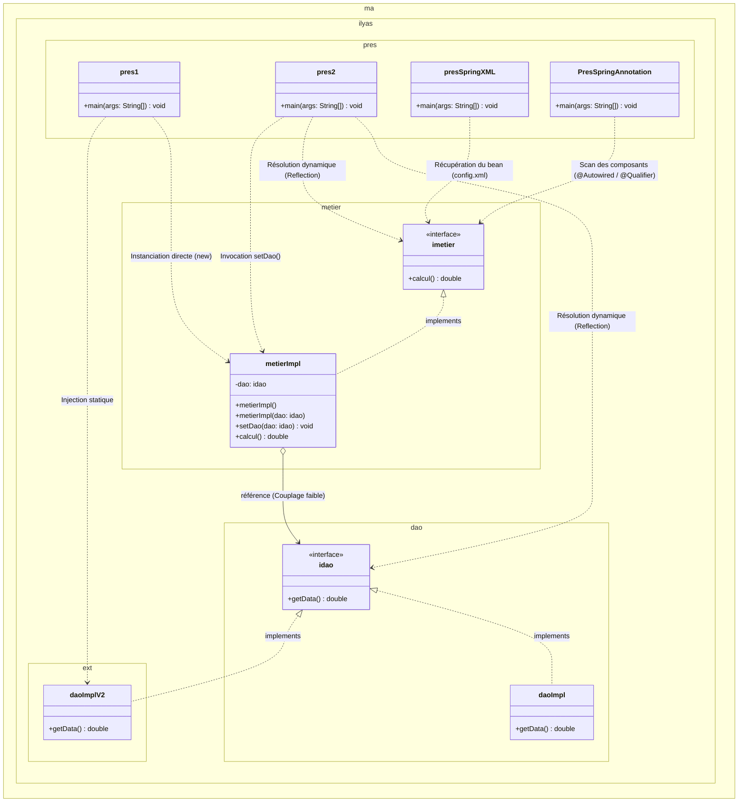
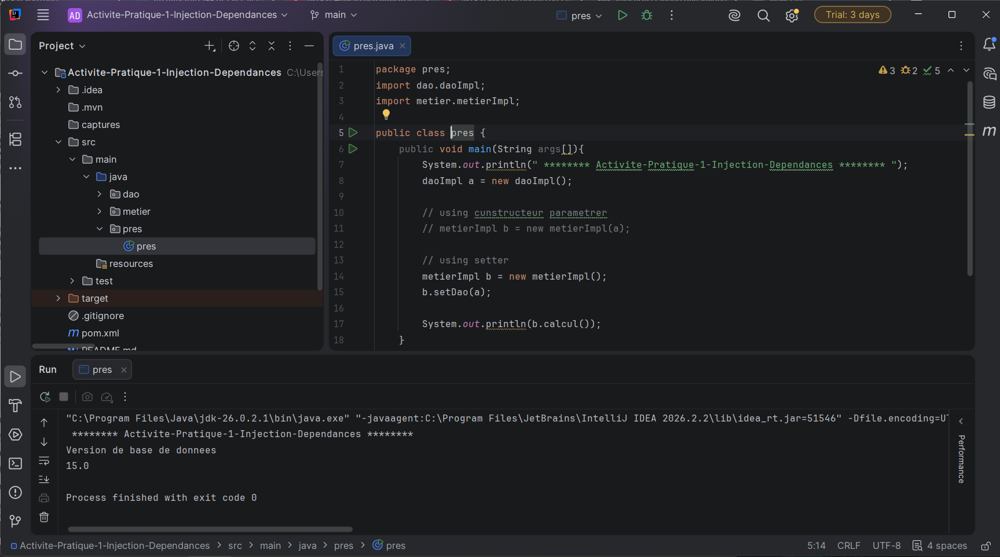
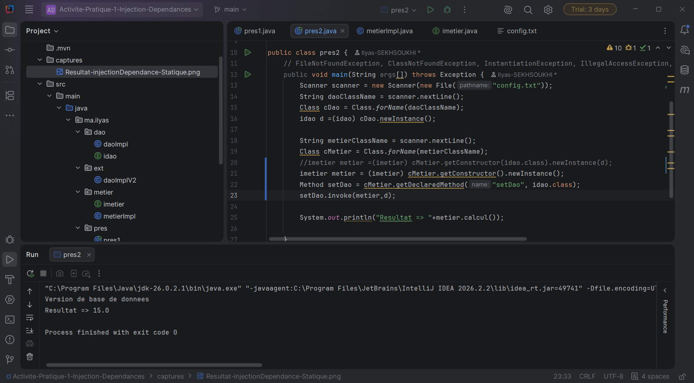

# Activité Pratique N°1 : Inversion de Contrôle (IoC) et Injection des Dépendances (DI)

> **Réalisé par :** **Ilyas SEKHSOUKHI**  
> **Filière :** 2ACI – Architecture JEE et Java avancé  
> **Cadre :** Activités Pratiques – Inversion de Contrôle (IoC) & Injection des Dépendances (DI)

---

## 📑 Sommaire

1. [Introduction & Contexte](#-introduction--contexte)
2. [Objectifs de l'activité](#-objectifs-de-lactivit%C3%A9)
3. [Architecture & Diagramme de Classes](#-%EF%B8%8F-architecture--diagramme-de-classes)
4. [Structure du Projet](#-structure-du-projet)
5. [Détail des Couches et Code Source](#-d%C3%A9tail-des-couches-et-code-source)
   - [1. Couche DAO (Accès aux Données)](#1-couche-dao-acc%C3%A8s-aux-donn%C3%A9es)
   - [2. Couche Métier](#2-couche-m%C3%A9tier)
   - [3. Approche 1 : Injection Statique (`pres1`)](#3-approche-1--injection-statique-pres1)
   - [4. Approche 2 : Injection Dynamique par Réflexion & `config.txt` (`pres2`)](#4-approche-2--injection-dynamique-par-r%C3%A9flexion--configtxt-pres2)
   - [5. Approche 3 : Injection Spring via Fichier XML (`presSpringXML`)](#5-approche-3--injection-spring-via-fichier-xml-presspringxml)
   - [6. Approche 4 : Injection Spring via Annotations (`PresSpringAnnotation`)](#6-approche-4--injection-spring-via-annotations-presspringannotation)
6. [Captures d'écran & Validation](#-captures-d%C3%A9cran--validation)
7. [Tableau Comparatif des Approches](#-tableau-comparatif-des-approches)
8. [Guide de Compilation & Exécution](#-%EF%B8%8F-guide-de-compilation--ex%C3%A9cution)
9. [Conclusion & Bonnes Pratiques](#-conclusion--bonnes-pratiques)

---

## 🌟 Introduction & Contexte

Dans la conception d'applications modulaires et évolutives, le principe de **responsabilité unique (SRP)** et le principe d'**inversion des dépendances (DIP)** (lettre *D* de SOLID) stipulent qu'un module de haut niveau ne doit pas dépendre directement de modules de bas niveau, mais plutôt d'**abstractions (interfaces)**.

L'**Inversion de Contrôle (IoC - Inversion of Control)** transfère la responsabilité d'instanciation et d'assemblage des objets à une entité externe (code principal, fabrique ou conteneur IoC comme Spring).

Ce projet explore et compare concrètement les **4 piliers de l'injection des dépendances** en Java :
1. **L'injection statique** (par instanciation directe avec l'opérateur `new`).
2. **L'injection dynamique manuelle** (via l'API Réflexion de Java et un fichier de configuration texte externe `config.txt`).
3. **L'injection dynamique via conteneur Spring IoC configuré par XML** (`config.xml`).
4. **L'injection dynamique via conteneur Spring IoC configuré par Annotations** (`@Component`, `@Autowired`, `@Qualifier`).

---

## 🎯 Objectifs de l'activité

1. **Conception d'interfaces modulaires** :
   - `idao` : déclare la méthode `double getData()`.
   - `imetier` : déclare la méthode `double calcul()`.
2. **Implémentations interchangeables du DAO** :
   - `daoImpl` : simule un accès à une base de données (retourne `10.0`).
   - `daoImplV2` : simule une consommation de service web (retourne `20.0`).
3. **Implémentation métier en couplage faible** :
   - `metierImpl` dépend exclusivement de l'interface `idao` (aucun import ou mention de classes concrètes DAO).
   - Support de l'injection par constructeur et par mutateur (`setter`).
4. **Mise en œuvre des différentes variantes d'injection** :
   - Injection statique directe.
   - Injection dynamique pure Java (Réflexion : `Class.forName()`, `newInstance()`, `Method.invoke()`).
   - Injection déclarative avec Spring Framework (XML et Annotations).
5. **Respect du principe Open/Closed (OCP)** :
   - Permettre l'extension du système (ex. basculer de `daoImpl` vers `daoImplV2`) sans modifier ni recompiler les classes métier existantes.

---

## 🏗️ Architecture & Diagramme de Classes

Le diagramme suivant illustre le découpage en packages, le rôle des interfaces et la façon dont les différentes classes de présentation assemblent les composants :



---

## 📂 Structure du Projet

```text
Activite-Pratique-1-Injection-Dependances/
├── captures/
│   ├── Resultat-injectionDependance-Statique.png       # Exécution de l'injection statique
│   └── Resultat-injectionDependance-Dynamique.png      # Exécution de l'injection dynamique
├── config.txt                                         # Configuration externe pour l'injection dynamique
├── pom.xml                                            # Dépendances Maven (Spring Core, Context, Beans)
├── README.md                                          # Rapport technique complet
└── src/
    └── main/
        ├── java/
        │   └── ma.ilyas/
        │       ├── dao/
        │       │   ├── idao.java                      # Interface du DAO
        │       │   └── daoImpl.java                   # Implémentation DAO Base de Données (@Component("d"))
        │       ├── ext/
        │       │   └── daoImplV2.java                 # Implémentation DAO Web Service (@Component("d2"))
        │       ├── metier/
        │       │   ├── imetier.java                   # Interface Métier
        │       │   └── metierImpl.java                # Implémentation Métier en couplage faible
        │       └── pres/
        │           ├── pres1.java                     # 1. Injection statique (new)
        │           ├── pres2.java                     # 2. Injection dynamique par réflexion (config.txt)
        │           ├── presSpringXML.java             # 3. Injection Spring via XML (config.xml)
        │           └── PresSpringAnnotation.java      # 4. Injection Spring via Annotations (@Autowired)
        └── resources/
            └── config.xml                             # Fichier de beans Spring pour l'injection XML
```

---

## 💻 Détail des Couches et Code Source

### 1. Couche DAO (Accès aux Données)

#### Interface `idao.java` (`ma.ilyas.dao`)
Définit le contrat d'accès aux données :
```java
package ma.ilyas.dao;

public interface idao {
    double getData();
}
```

#### Implémentation V1 : `daoImpl.java` (`ma.ilyas.dao`)
Simule l'accès à une base de données relationnelle. L'annotation `@Component("d")` permet au conteneur Spring d'enregistrer ce composant sous l'identifiant `"d"`.
```java
package ma.ilyas.dao;
import org.springframework.stereotype.Component;

@Component("d")
public class daoImpl implements idao {
    // Par exemple version DataBase
    @Override
    public double getData() {
        System.out.println("Version de base de donnees");
        return 10;
    }
}
```

#### Implémentation V2 : `daoImplV2.java` (`ma.ilyas.ext`)
Simule un appel à un service web distant. L'annotation `@Component("d2")` l'enregistre avec l'alias `"d2"`.
```java
package ma.ilyas.ext;
import ma.ilyas.dao.idao;
import org.springframework.stereotype.Component;

@Component("d2")
public class daoImplV2 implements idao {
    // Par exemple version WebUI
    @Override
    public double getData() {
        System.out.println("Version de web service");
        return 20;
    }
}
```

---

### 2. Couche Métier

#### Interface `imetier.java` (`ma.ilyas.metier`)
Définit le contrat de traitement métier :
```java
package ma.ilyas.metier;

public interface imetier {
    double calcul();
}
```

#### Implémentation : `metierImpl.java` (`ma.ilyas.metier`)
Cette classe est conçue selon le principe du **couplage faible** :
- Elle possède un attribut de type `idao` (l'interface), et **aucune dépendance directe** vers `daoImpl` ou `daoImplV2`.
- Elle supporte l'injection par **constructeur paramétré** et par **setter**.
- Pour Spring par annotations, elle intègre `@Autowired` et `@Qualifier("d2")` pour lever l'ambiguïté entre les deux implémentations DAO disponibles.

```java
package ma.ilyas.metier;
import ma.ilyas.dao.idao;
import org.springframework.beans.factory.annotation.Autowired;
import org.springframework.beans.factory.annotation.Qualifier;
import org.springframework.stereotype.Component;

@Component("metier")
public class metierImpl implements imetier {
    @Autowired
    @Qualifier("d2")
    private idao dao;

    public metierImpl() {}

    public metierImpl(idao dao) { // Constructeur paramétré
        this.dao = dao;
    }

    public void setDao(idao dao) { // Setter
        this.dao = dao;
    }

    @Override
    public double calcul() {
        double a = dao.getData();
        double resultat = a + 5;
        return resultat;
    }
}
```

---

### 3. Approche 1 : Injection Statique (`pres1`)

L'instanciation et l'injection sont codées « en dur » à l'aide du mot-clé `new` :
```java
package ma.ilyas.pres;
import ma.ilyas.dao.daoImpl;
import ma.ilyas.ext.daoImplV2;
import ma.ilyas.metier.metierImpl;

public class pres1 {
    public static void main(String[] args){
        System.out.println(" ******** Activite-Pratique-1-Injection-Dependances ******** ");
        daoImplV2 a = new daoImplV2();

        // Option 1 : Injection par constructeur paramétré
        // metierImpl b = new metierImpl(a);

        // Option 2 : Injection par Setter
        metierImpl b = new metierImpl();
        b.setDao(a);

        System.out.println(b.calcul());
    }
}
```

> **Analyse :**
> - **Avantage :** Simple, rapide, vérifié dès la compilation.
> - **Inconvénient :** Couplage fort au niveau de la classe de présentation. Pour basculer d'une implémentation DAO à une autre, il faut **modifier le code source et recompiler l'application**.

---

### 4. Approche 2 : Injection Dynamique par Réflexion & `config.txt` (`pres2`)

Cette approche sépare totalement le code exécutable de sa configuration.

#### Fichier de configuration externe `config.txt` :
```text
ma.ilyas.dao.daoImpl
ma.ilyas.metier.metierImpl
```

#### Code du lanceur dynamique `pres2.java` :
```java
package ma.ilyas.pres;
import ma.ilyas.dao.idao;
import ma.ilyas.metier.imetier;
import java.io.File;
import java.lang.reflect.Method;
import java.util.Scanner;

public class pres2 {
    public static void main(String[] args) throws Exception {
        // 1. Lecture du fichier de configuration externe
        Scanner scanner = new Scanner(new File("config.txt"));

        // 2. Chargement dynamique de la classe DAO et instanciation
        String daoClassName = scanner.nextLine();
        Class cDao = Class.forName(daoClassName);
        idao d = (idao) cDao.newInstance();

        // 3. Chargement dynamique de la classe Métier et instanciation
        String metierClassName = scanner.nextLine();
        Class cMetier = Class.forName(metierClassName);
        imetier metier = (imetier) cMetier.getConstructor().newInstance();

        // 4. Injection dynamique de la dépendance via la méthode setDao(idao)
        Method setDao = cMetier.getDeclaredMethod("setDao", idao.class);
        setDao.invoke(metier, d);

        // 5. Exécution du traitement métier
        System.out.println("Resultat => " + metier.calcul());
    }
}
```

> **Analyse & Principe OCP (Open/Closed Principle) :**
> - L'application est **fermée à la modification** : aucune modification de code ni recompilation n'est nécessaire.
> - L'application est **ouverte à l'extension** : pour passer au DAO V2, il suffit de remplacer la première ligne de `config.txt` par `ma.ilyas.ext.daoImplV2`.

---

### 5. Approche 3 : Injection Spring via Fichier XML (`presSpringXML`)

Ici, la gestion du cycle de vie des objets et l'injection sont déléguées au **conteneur IoC de Spring** configuré par un descripteur XML.

#### Fichier de configuration `src/main/resources/config.xml` :
```xml
<?xml version="1.0" encoding="UTF-8"?>
<beans xmlns="http://www.springframework.org/schema/beans"
       xmlns:xsi="http://www.w3.org/2001/XMLSchema-instance"
       xsi:schemaLocation="http://www.springframework.org/schema/beans http://www.springframework.org/schema/beans/spring-beans.xsd">

    <!-- Déclaration du bean DAO (ici daoImplV2) avec l'identifiant "d" -->
    <bean id="d" class="ma.ilyas.ext.daoImplV2"></bean>

    <!-- Déclaration du bean Métier avec injection du bean "d" via sa propriété dao (setDao) -->
    <bean id="metier" class="ma.ilyas.metier.metierImpl">
        <property name="dao" ref="d"></property>
    </bean>

</beans>
```

#### Code du lanceur Spring XML `presSpringXML.java` :
```java
package ma.ilyas.pres;

import ma.ilyas.metier.imetier;
import org.springframework.context.ApplicationContext;
import org.springframework.context.support.ClassPathXmlApplicationContext;

public class presSpringXML {
    public static void main(String[] args){
        // Démarrage du conteneur IoC Spring à partir du fichier XML du classpath
        ApplicationContext springContext = new ClassPathXmlApplicationContext("config.xml");

        // Récupération du bean métier configuré et prêt à l'emploi
        imetier metier = (imetier) springContext.getBean("metier");

        // Appel métier
        System.out.println("Resultat => " + metier.calcul());
    }
}
```

---

### 6. Approche 4 : Injection Spring via Annotations (`PresSpringAnnotation`)

Cette approche moderne élimine le besoin de fichier XML ou de configuration externe en s'appuyant sur les annotations Java standards de Spring :
- `@Component` : marque la classe comme un bean géré par Spring.
- `@Autowired` : demande au conteneur d'injecter automatiquement la dépendance requise.
- `@Qualifier("d2")` : spécifie explicitement quel bean injecter lorsque plusieurs implémentations de `idao` coexistent.

#### Code du lanceur Spring Annotations `PresSpringAnnotation.java` :
```java
package ma.ilyas.pres;

import ma.ilyas.metier.imetier;
import org.springframework.context.ApplicationContext;
import org.springframework.context.annotation.AnnotationConfigApplicationContext;

public class PresSpringAnnotation {
    public static void main(String[] args){
        // Initialisation du conteneur Spring en scannant le package "ma.ilyas"
        ApplicationContext applicationContext = new AnnotationConfigApplicationContext("ma.ilyas");

        // Récupération du bean de type imetier
        imetier metier = applicationContext.getBean(imetier.class);

        // Appel métier
        System.out.println("Le resultat avec spring Annotation est :" + metier.calcul());
    }
}
```

---

## 📸 Captures d'écran & Validation

### 1. Résultat de l'Injection Statique (`pres1`)

Exécution avec l'implémentation injectée dans `metierImpl` :
- Résultat console : affichage de la source de données et du calcul.
- **Image de validation :**



---

### 2. Résultat de l'Injection Dynamique (`pres2`)

Exécution avec configuration via `config.txt` (`daoImpl` et `metierImpl`) :
- Lecture dynamique du fichier externe.
- Instanciation via l'API Réflexion Java (`Class.forName`, `newInstance`, `invoke`).
- **Image de validation :**



---

## 🔄 Tableau Comparatif des Approches

| Critère | 1. Injection Statique (`pres1`) | 2. Injection Dynamique Réflexion (`pres2`) | 3. Spring IoC via XML (`presSpringXML`) | 4. Spring IoC via Annotations (`PresSpringAnnotation`) |
|---|---|---|---|---|
| **Mécanisme d'instanciation** | Opérateur `new` explicite | `Class.forName()`, `newInstance()` | Conteneur Spring (`BeanFactory` / `ApplicationContext`) | Scan automatique (`AnnotationConfigApplicationContext`) |
| **Mécanisme d'injection** | Appel direct du constructeur ou du setter | Réflexion (`Method.invoke("setDao", ...)`) | Balise `<property ref="..."/>` dans `config.xml` | `@Autowired` + `@Qualifier` |
| **Niveau de couplage** | Fort dans la couche présentation | Faible (aucune référence aux classes concrètes) | Faible (découplage total) | Faible (découplage total) |
| **Respect du principe OCP** | ❌ Non (nécessite recompilation) | ✅ Oui (modification du fichier `config.txt`) | ✅ Oui (modification du fichier `config.xml`) | ✅ Oui (changement du `@Qualifier` ou profil Spring) |
| **Gestion du cycle de vie** | Manuelle | Manuelle | Automatisée par Spring (Singleton, Prototype, etc.) | Automatisée par Spring (Singleton, Prototype, etc.) |
| **Vérification syntaxique** | À la compilation | Au runtime | Au démarrage du conteneur (runtime) | Au démarrage du conteneur / analyse statique IDE |

---

## 🛠️ Guide de Compilation & Exécution

### Prérequis
- **Java JDK :** Version 17 ou supérieure (compatible JDK 21 / JDK 26)
- **Maven :** 3.8+ ou intégration Maven d'un IDE (IntelliJ IDEA, Eclipse, VS Code)

### Dépendances Maven (`pom.xml`)
Le projet intègre Spring Framework 7 pour les démonstrations IoC :
```xml
<dependencies>
    <dependency>
        <groupId>org.springframework</groupId>
        <artifactId>spring-core</artifactId>
        <version>7.0.9</version>
    </dependency>
    <dependency>
        <groupId>org.springframework</groupId>
        <artifactId>spring-context</artifactId>
        <version>7.0.9</version>
    </dependency>
    <dependency>
        <groupId>org.springframework</groupId>
        <artifactId>spring-beans</artifactId>
        <version>7.0.9</version>
    </dependency>
</dependencies>
```

### Exécution depuis un IDE (ex. IntelliJ IDEA)
1. Cloner ou ouvrir le dossier du projet dans l'IDE.
2. Synchroniser les dépendances Maven (**Maven -> Reload Project**).
3. Exécuter la classe souhaitée :
   - Clic droit sur `pres1.java` ➡️ **Run 'pres1.main()'**
   - Clic droit sur `pres2.java` ➡️ **Run 'pres2.main()'**
   - Clic droit sur `presSpringXML.java` ➡️ **Run 'presSpringXML.main()'**
   - Clic droit sur `PresSpringAnnotation.java` ➡️ **Run 'PresSpringAnnotation.main()'**

---

## 💡 Conclusion & Bonnes Pratiques

Cette activité pratique démontre concrètement l'évolution de la gestion des dépendances dans les architectures logicielles :
1. **L'instanciation directe (`new`)** crée une rigidité qui rend les tests unitaires complexes et freine l'évolutivité.
2. **L'injection dynamique manuelle par réflexion** résout le problème de dépendance au code source en déportant la configuration dans un fichier externe, mais impose une gestion verbeuse des exceptions et du cycle de vie des objets.
3. **Le Framework Spring** combine le meilleur des deux mondes en industrialisant ce mécanisme grâce à son conteneur IoC : gestion transparente des cycles de vie, injection par XML ou par annotations (`@Component`, `@Autowired`), et flexibilité totale conforme aux principes d'architecture logicielle moderne.

---

## 👤 Auteur

- **Étudiant :** **Ilyas SEKHSOUKHI**
- **Formation :** 2ACI – Architecture JEE et Java avancé
